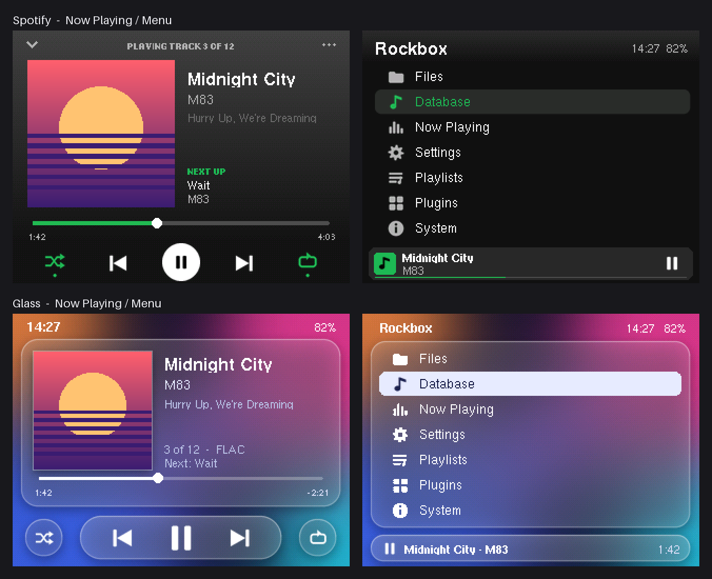

# Rockbox themes for iPod Classic

Rockbox install tooling and five themes for an **iPod Classic 7th gen** (160 GB, late 2009). The Rockbox target for every iPod Classic is `ipod6g`, and the screen is 320x240.



## What is Rockbox?

[Rockbox](https://www.rockbox.org) is an open-source firmware that replaces the music player software on many portable players, including the iPod Classic. It doesn't need iTunes or Finder: you drag music onto the disk like a USB stick. It also gives you:

- FLAC, Opus, OGG, ALAC, WavPack and many more formats, gapless playback, replaygain, EQ and crossfeed
- fully themeable UI (the files in this repo)
- folder browsing or a tag database, plugins and games

The bootloader installs as a **dual boot**. The Apple firmware stays on the device and you can boot either one.

## Repo layout

```
themes/<name>/.rockbox/   each theme as a ready-to-copy .rockbox tree
src/build.py              generates spotify + glass (skins, bitmaps, cfg, previews)
src/bdf/                  Rockbox fonts as BDF, used to render accurate previews
preview/                  mockups of spotify + glass
justfile                  all the commands below
```

| Theme | Author | Licence | Notes |
|---|---|---|---|
| `spotify` | me | | generated by `src/build.py`, needs the standard fonts pack |
| `glass` | me | | generated by `src/build.py`, needs the standard fonts pack |
| `classic-revival` | Doug Belshaw, based on iClassic by Humberto Santana | CC BY-SA 4.0 | [source](https://framagit.org/dajbelshaw/rockbox-classic-revival), needs Rockbox 4.0+, see `wps/ClassicRevival-known-issues.txt` |
| `interpod` | Christian Soffke | CC BY-SA | made for iPod Video (same 320x240 screen) |
| `ipod-refresh-three` | dr3am.r | CC BY-SA 3.0 | |

The third-party themes were unpacked as-is from their release zips.

## Requirements

- macOS with [`just`](https://github.com/casey/just) (`brew install just`), Python 3 and Xcode command line tools (`xcode-select --install`, used to build the bootloader installer)
- **The iPod must be FAT32 ("WinPod").** Rockbox can't run from an HFS+ ("MacPod") iPod, and an iPod restored with Finder or iTunes on a Mac is HFS+. Plug it in and run `just status`: `File System Personality` must say `MS-DOS FAT32`. If it doesn't, restore it from iTunes **on Windows** (a VM works), which formats it as FAT32. See [IpodConversionToFAT32](https://www.rockbox.org/wiki/IpodConversionToFAT32).
- **Supported Apple firmware.** The bootloader installer checks the Apple firmware version (Settings > About on the iPod):

  | Model | Firmware |
  |---|---|
  | 80/160 GB, late 2007 | 1.1.2 |
  | 120 GB, late 2008 | 2.0.1 |
  | **160 GB, late 2009 (7th gen)** | **2.0.4** |
  | 160 GB, late 2012 (7th gen, later units) | 2.0.5 |

## Install Rockbox (first time)

1. **Back up your music.** The install doesn't delete anything, but a FAT32 conversion does.
2. Plug the iPod in (Apple firmware, it mounts as a disk) and run:

   ```
   just setup
   ```

   This does two things:
   - **`just rockbox`** downloads Rockbox 4.0 and the standard fonts pack for `ipod6g` and unpacks them into `.rockbox/` on the iPod. Use `ROCKBOX=daily just setup` for the nightly build.
   - **`just bootloader`** builds `mks5lboot` from the Rockbox source (there is no macOS binary), downloads `bootloader-ipod6g.ipod`, and waits for DFU mode. When it says *Waiting...*, quit Music/iTunes and **hold SELECT + MENU for about 12 seconds** until the screen stays black. The iPod beeps once when the installer loads and twice when it's done, then reboots into Rockbox.

     A single long low tone means the install failed, and the iPod reboots into the Apple firmware unharmed. If you hear three low tones, the NOR flash is corrupted and you need to restore with iTunes. That shouldn't happen.

If `mks5lboot` can't access USB, run `sudo .cache/mks5lboot --bl-inst .cache/bootloader-ipod6g.ipod` while the iPod is in DFU mode.

Prefer a GUI? [Rockbox Utility](https://www.rockbox.org/wiki/RockboxUtility) can do the `just rockbox` part on macOS. The bootloader for this model still has to go through `mks5lboot`.

## Install themes

With Rockbox running, plug the iPod in. It enters USB mode and mounts as a disk.

```
just flash                 # build, back up .rockbox, copy ALL themes, eject
just flash spotify glass   # same, only these themes
```

Then on the iPod: **Settings > Theme Settings > Browse Theme Files** and pick a theme.

Other commands:

```
just themes            # list themes
just status            # filesystem, Rockbox version, themes on the iPod
just install glass     # copy without building/backing up/ejecting
just uninstall interpod
just backup            # copy the iPod's .rockbox to backups/<timestamp>
just restore backups/20261109-201500
just fonts             # (re)install the standard fonts pack
just eject
```

The iPod is auto-detected as the first `/Volumes/*` with `iPod_Control` or `.rockbox`. Override it with `IPOD=/Volumes/NAME just ...`.

For album art, put a `cover.jpg` (baseline, not progressive) or `cover.bmp` in each album folder.

## Switching between Rockbox and Apple firmware

The bootloader checks the buttons about 0.8 s after power-on:

| Hold at boot | Result |
|---|---|
| nothing | Rockbox |
| MENU | Apple firmware |
| Hold switch on (before "Loading Rockbox..." appears) | Apple firmware. Don't leave Hold on while Rockbox starts or it resets your Rockbox settings |
| SELECT + RIGHT | bootloader USB mode (to fix a broken Rockbox install) |
| SELECT + PLAY | Apple disk mode |
| SELECT + MENU (keep holding) | reset, then DFU mode after about 8 more seconds |

- **Rockbox to Apple:** shut down (hold PLAY), then power on while holding MENU.
- **Apple to Rockbox:** hold SELECT + MENU until the iPod resets, then release.

## Reverting to stock

- **Just a theme:** pick another theme on the device (or `just uninstall <name>` to delete its files).
- **Settings:** `just restore backups/<timestamp>` copies a backup back.
- **Remove Rockbox completely:**
  1. `just uninstall-bootloader`, then put the iPod in DFU mode (SELECT + MENU about 12 s) when asked. It removes the Rockbox bootloader, and the iPod boots straight into the Apple firmware again.
  2. Boot the Apple firmware, plug the iPod in (disk mode), and delete the `.rockbox` folder from the iPod.

  Your music stays put. To sync music with Finder again, the Apple firmware doesn't need anything else. A full Finder restore also works, but it wipes the disk and reformats it as HFS+.

## Editing spotify / glass

Everything for these two themes is generated by `src/build.py`: the `.wps`/`.sbs`/`.cfg` files, every bitmap and the previews. Change the coordinates or colours in the script, then:

```
just build    # creates .venv with Pillow on first run, writes themes/{spotify,glass} and preview/
```

The themes use `10/12/15-Adobe-Helvetica` and `10/12/14/18-Adobe-Helvetica-Bold` from the standard fonts pack.
